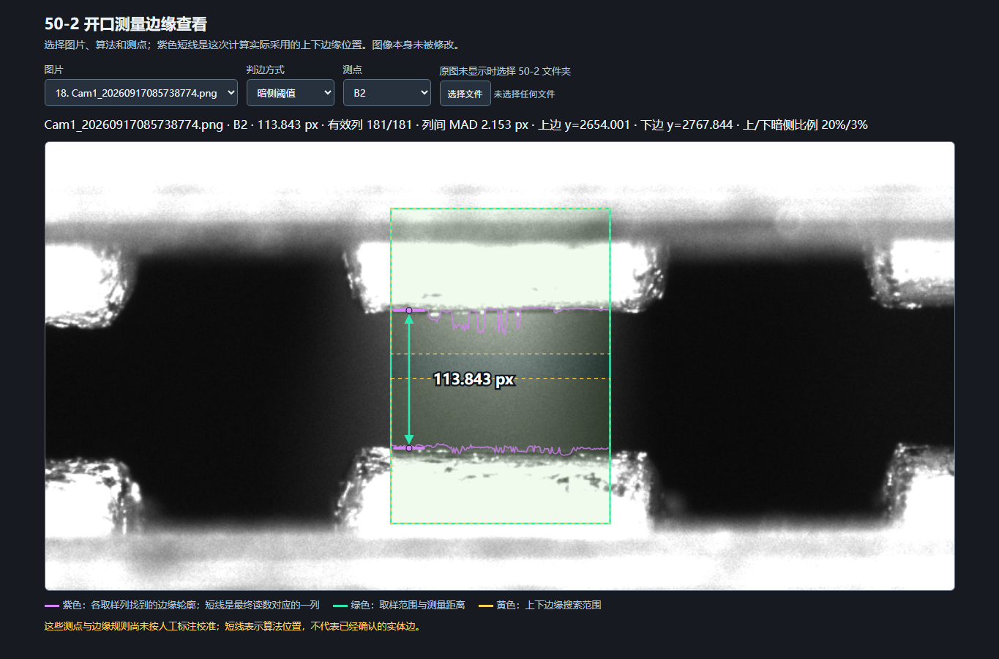

# 开口间距检测方法：0916 与 50-2 长直边试测

本文说明 `opening_gap_median` 算法的实际计算过程，并分别记录 **0916 产品的 49 列配置**和 **50-2 图像的长直边候选配置**。两批图像均为 5472 × 3648，以下坐标与距离均以原图像素为单位。它测的是每个开口内指定上、下边缘之间的竖直距离。用户截图中的红线是人工指出的**参考实体边缘**，并不是原始图片中的红色像素；程序不会识别或读取这条红线，而是根据原图灰度、ROI 和参数重新找边。

**先看结论：**0916 已配置进其产品流程，按中心 49 列取每列距离的中位数。50-2 目前只有离线脚本和可视化查看页；针对用户画出长红线的 B2，以及结构相似的 T2，试验了中心 181 列和单独校准的上边缘阈值。50-2 的候选参数尚未写入 EXE 产品配方，且不是全部实体边缘均已标注验证。

## 1. 测量对象与边缘定义

0916 每张图有上排 `U1`–`U7` 和下排 `L1`–`L7`，共 14 处。对其中一处，沿原图中的竖直像素列观察：

1. 上方亮区进入暗间隙，灰度下降，得到上边缘 `y上`。
2. 暗间隙进入下方亮区，灰度上升，得到下边缘 `y下`。
3. 同一列的间距为 `d = y下 − y上`。

这里的“边缘”采用明暗过渡**靠暗区一侧**的位置。显示的紫色短线是程序选出的上下测量点，绿色双向箭头连接这两个点；不能仅凭大范围 ROI 框或图上的其他辅助线判断实际测量位置。算法在中位数对应的一列画一组短线。50-2 离线查看页还能画出所有有效列各自找到的上下边缘轮廓；这条可视化轮廓**不是直线拟合结果**。

## 2. 定位区域与 49 列取样

每处先在基准图上指定一个开口中心。0916 的 Shape 定位配方为每处配置宽约 **180 px** 的矩形 ROI，用来容纳和显示该开口，并随产品定位结果投影到当前图。真正用于算间距的是 ROI **中心连续 49 列**，即中心列左右各 24 列。

ROI 画得比取样带宽，是为了让开口位置和上下搜索范围有足够覆盖；取样保持窄，是为了避开左右圆角、邻近结构和明显倾斜的端部。因此“ROI 框宽度”和“参与测量的列数”是两个不同参数。若 49 列跨过反光、圆角或结构突变，应调整中心或宽度，再重新验证。

每处另设互不重叠的上、下搜索窗口。上窗口只允许找下降沿，下窗口只允许找上升沿；这样可以减少把反光、外侧轮廓或其他零件边缘当成目标边的机会。窗口坐标随 Shape ROI 投影到被测图，不能把原图固定坐标直接用于其他版式或相机位置。

## 3. 单列找边的实际步骤

以下步骤对 49 列逐列独立执行，当前 0916 使用 `edge_mode = dark_plateau`。

### 3.1 灰度与平滑

彩色图先转灰度。对每列在竖直方向使用 **9 像素高斯平滑**，再计算相邻像素的灰度差：

```text
Δg(y) = g(y+1) − g(y)
```

平滑用于抑制孤立噪声和细小亮点；它也会改变过渡形状，所以边缘规则和参数必须结合实际图像校准。

### 3.2 在各自窗口内确定过渡

- 上窗口：找 `−Δg(y)` 最大处，即最明显的亮到暗过渡。
- 下窗口：找 `Δg(y)` 最大处，即最明显的暗到亮过渡。

这一步找到的是过渡的参考位置，**不是直接返回最终边缘**。仅取最大梯度可能落在较亮的过渡带外侧，与 0916 人工红线不一致。

### 3.3 用该列局部明暗水平找暗侧边缘

程序分别从参考位置两侧取本列局部暗、亮灰度水平：`D` 为暗侧的最小灰度，`L` 为亮侧的最大灰度，然后计算阈值：

```text
T = D + f × (L − D)
```

上边缘从下降过渡向暗区查找首次达到 `g ≤ T` 的位置；下边缘从暗区向上升过渡查找最后一个 `g ≤ T` 的位置。对跨过阈值的相邻两个采样点做线性插值，因此边缘坐标和最后的间距可以是小数像素。

例如某列局部暗水平 `D = 20`、亮水平 `L = 220`，比例 `f = 0.03` 时，阈值为 `26`。它随该列明暗水平改变，并非固定灰度 128。程序先找正确方向的过渡，再在过渡暗侧找这个阈值，因此“最强梯度点”和“最后显示的边缘点”通常不是同一个位置。

0916 的一般设置为上、下两侧 `f = 0.03`；`U5` 上侧为 `0.08`、下侧为 `0.04`。这些比例来自 0916 图像及人工红线的校准，**不是所有产品通用的物理边界定义**。局部亮暗差小于 10 灰度级时，该侧边缘无效。

### 3.4 列有效性

上、下过渡的灰度差强度均须达到 `min_strength = 5.0`。只有两侧都满足条件的列才计入结果。49 列中至少需要 `ceil(49 × 0.6) = 30` 列有效；低于此数时程序报测量失败，不返回尺寸。这个门槛只能过滤明显无边或弱边，不能保证找到的一定是人工指定的边。

## 4. 多列距离合成一个读数

设有效列为 `i = 1…n`，每列分别得到 `y上,i` 和 `y下,i`：

```text
d_i = y下,i − y上,i
最终间距 D = median(d_1, d_2, …, d_n)
```

取**每列间距的中位数**，而不是先分别求上下边缘的中位数再相减。这样，少数列上的噪点和反光对最终读数的影响较小。结果还包含 `valid_columns`（有效列数）和 `mad_px = median(|d_i − D|)`（各列距离相对中位数的离散程度）。显示在图上的上下短线选自中位数对应的列；若有效列数为偶数，则取中间两列坐标的平均。取样宽度 `N` 可按测点配置为 49、181 等奇数，合成公式不变；有效列门槛为 `max(3, ceil(0.6 × N))`。

```text
对每个开口：
    由 Shape 结果取得该开口的 ROI
    取 ROI 中间 49 列
    对每列：
        竖直高斯平滑
        上窗口找下降过渡，下窗口找上升过渡
        在两个过渡的暗侧分别求亚像素边缘
        若两边强度合格，保存本列上下边缘之差
    若有效列少于 30 列，报测量失败
    否则输出全部有效列距离的中位数
```

若要输出毫米，应先用可靠标定得到 `pixel_size_mm`，再计算 `D_mm = D_px × pixel_size_mm`。当前 0916 配置只输出像素，尚未设置毫米标定和尺寸公差；界面中的 `OK` 只表示获得读数，不能据此认定产品尺寸合格。

## 5. 0916 当前配置

以下为基准原图中的参考中心及搜索窗口。实际运行时由产品的 Shape 定位结果投影到当前图。上排和下排各自共用一组竖直窗口，只有 `U5` 的暗侧比例另行设置。

| 位置 | 中心 x | 上边缘搜索 y | 下边缘搜索 y | 上侧比例 | 下侧比例 |
| --- | ---: | --- | --- | ---: | ---: |
| U1 | 1250 | 890–975 | 1015–1080 | 3% | 3% |
| U2 | 1650 | 890–975 | 1015–1080 | 3% | 3% |
| U3 | 2040 | 890–975 | 1015–1080 | 3% | 3% |
| U4 | 2440 | 890–975 | 1015–1080 | 3% | 3% |
| U5 | 2880 | 890–975 | 1015–1080 | 8% | 4% |
| U6 | 3155 | 890–975 | 1015–1080 | 3% | 3% |
| U7 | 3660 | 890–975 | 1015–1080 | 3% | 3% |
| L1 | 1335 | 2525–2610 | 2650–2720 | 3% | 3% |
| L2 | 1725 | 2525–2610 | 2650–2720 | 3% | 3% |
| L3 | 2115 | 2525–2610 | 2650–2720 | 3% | 3% |
| L4 | 2520 | 2525–2610 | 2650–2720 | 3% | 3% |
| L5 | 2920 | 2525–2610 | 2650–2720 | 3% | 3% |
| L6 | 3315 | 2525–2610 | 2650–2720 | 3% | 3% |
| L7 | 3690 | 2525–2610 | 2650–2720 | 3% | 3% |

这些数值记录在 [`config/examples/0916_opening_gaps.json`](../config/examples/0916_opening_gaps.json)。EXE 实际使用的测量工具参数位于产品 `inspection_items.json`，Shape 参考 ROI 位于 `shape/cam1/recipe.json`。先前为避开不理想的直边取样位置，`U6` 中心从 3235 调到 3155，`U7` 从 3620 调到 3660。

## 6. 验证结果与数据文件

对 0916 训练集的 **50 张原图**运行完整产品流程，14 处 × 50 张 = **700 处**，均得到数值；最少有 **47/49** 列有效，运行中没有报错。批量文件 [`reports/0916_opening_gap_runtime_50.csv`](../reports/0916_opening_gap_runtime_50.csv) 是每张图一行、14 个测量值并列，另有 `image` 和 `roi_count` 列；详细汇总见 [`reports/0916_opening_gap_runtime_summary.json`](../reports/0916_opening_gap_runtime_summary.json)。这些 CSV 值保留三位小数，单位为 px。

先前提供的人工红线截图只对 `U5`、`U6`、`U7` 的边缘位置作过目视对照。其余 11 处还缺少逐处人工标注或卡尺真值。**700/700 是读数成功率，不是测量准确率**。如果用调参后的同一批训练图评价，也不能把这项结果当成独立验证。

这份每图一行的批量 CSV 由验证脚本生成。EXE 调试界面逐图按“测试”时，产品目录 `test_logs` 中的日 CSV 是**每个测量项一行**；界面“导出报表”只导出当前显示的结果。它们与上述 50 行、每行 14 个值的批量文件不是同一种记录格式。

## 7. 适用条件与换产品时的处理

该方法适用于：开口中部有一对相对稳定的上、下亮暗过渡；测量方向近似竖直；能把两条目标边分别限制在搜索窗口内；选定的中心取样列大体落在同一段直边上。

换产品时，需要重新确认**测量的是哪两条实体边**，并重新设置测点数量、中心列、上下窗口、取样宽度、明暗比例及标定。反光、饱和、灰色中间结构、边缘弯曲或产品转角都可能产生另一组“亮→暗→亮”过渡；即便程序返回稳定数字，也可能找错边。下文的 `50-2` 图像就是独立试测案例，0916 的坐标和 3% 参数不能直接沿用。

## 8. 对应实现

- 核心逐列检测与中位数：[`algorithms/measurement_opening_gap.py`](../algorithms/measurement_opening_gap.py)
- Shape ROI 裁切、局部坐标和原图坐标换算：[`algorithms/measurement.py`](../algorithms/measurement.py)
- 0916 产品配置生成：[`tools/setup_0916_opening_gap_release.py`](../tools/setup_0916_opening_gap_release.py)
- 50 张图完整产品流程批量验证：[`tools/validate_opening_gap_runtime_0916.py`](../tools/validate_opening_gap_runtime_0916.py)

---

## 9. 50-2：为什么要另设一套测点

`50-2` 的原始 50 张图与 0916 不是同一种开口布局。这里暂按图中四个横槽内的亮边来解释：上方两槽合计 `T1`–`T6` 六处，下方两槽合计 `B1`–`B6` 六处，共 **12 处小开口间距**。这不是四个横槽各自的整体高度，也不是 0916 的 14 处。若目标尺寸定义改变，必须重新布置测点，不能沿用本文的结果。

本轮 50-2 采用**原图固定坐标**离线试测。与 0916 的完整产品流程不同，50-2 尚未建立新的 Shape 定位配方，故目前既不能把这些原图坐标视为可适应任意工件位姿的方案，也不能说 EXE 已经有 50-2 产品检测功能。离线脚本只读取输入目录中符合 `Cam1_20260917*.png` 的 50 张 5472 × 3648 图像。这样做是为了明确本次分析的图像集合；不同视角、不同照明或移动较大的新图需要重新定位并复核。

### 9.1 测点与坐标

| 测点 | 中心 x | 上边缘搜索 y | 下边缘搜索 y | 初版列数 | 长边候选列数 |
| --- | ---: | --- | --- | ---: | ---: |
| T1 | 1210 | 930–1030 | 1050–1150 | 49 | 49 |
| T2 | 1650 | 930–1030 | 1050–1150 | 49 | **181** |
| T3 | 2090 | 930–1030 | 1050–1150 | 49 | 49 |
| T4 | 2990 | 930–1030 | 1050–1150 | 49 | 49 |
| T5 | 3425 | 930–1030 | 1050–1150 | 49 | 49 |
| T6 | 3870 | 930–1030 | 1050–1150 | 49 | 49 |
| B1 | 1210 | 2570–2690 | 2710–2830 | 49 | 49 |
| B2 | 1650 | 2570–2690 | 2710–2830 | 49 | **181** |
| B3 | 2090 | 2570–2690 | 2710–2830 | 49 | 49 |
| B4 | 2990 | 2570–2690 | 2710–2830 | 49 | 49 |
| B5 | 3425 | 2570–2690 | 2710–2830 | 49 | 49 |
| B6 | 3870 | 2570–2690 | 2710–2830 | 49 | 49 |

例如 B2 的 `center_x = 1650`、`width = 181`，意味着实际检查原图中的 **x = 1560…1740**，共 181 列，而不是只在 x = 1650 量一次。每列的上边缘必须在 B2 的上窗口内，下边缘必须在 B2 的下窗口内。上、下窗口之间有一段不参与找边的暗间隙。T2 也取 x = 1560…1740，但竖直窗口位于图像上方。50-2 没有另行使用一个宽 180 px 的 Shape ROI；0916 的“Shape 框宽 180、计算只取 49 列”关系不能套到这里。

### 9.2 “沿长红线计算”的准确含义

用户截图上的长红线用于说明**希望测量的实体轮廓**。程序对未标线的原图取样：

```text
原图中选择一个横向直边段
    ↓
在这段中间选 181 个连续 x 列，避开两端圆角
    ↓
每列分别找一个上边缘和一个下边缘
    ↓
每列算一次竖直距离，最后对 181 个距离取中位数
```

因此“181 列”代表**沿长红线方向扩大取样范围**，并不代表把红线当作一个图像对象读取，也不代表对红线作最小二乘直线拟合。原图查看页显示的紫色起伏曲线是这些列的逐列检测点连起来的结果；曲线向暗区突出的尖峰反映局部反光、灰度纹理或错误边缘候选。最终读数由各列的**间距中位数**决定，不会逐点平均这条曲线。

## 10. 50-2 B2 的错误边缘是怎么发生的

B2 的上方亮边下面还有较亮的灰色结构。沿一些竖直列往下看，灰度变化可能是“白 → 灰 → 更暗”，而不是一次完成的“白 → 黑”。在初版 `upper_dark_fraction = 0.03` 时，局部阈值非常靠近最暗水平；即便程序已经找到亮到暗的主要过渡，它还会继续向下寻找接近暗区底部的灰度。结果上紫线会落到用户上红线**下方**，把应测距离算短。

以用户截图所选的 `Cam1_20260917085738774.png` 的 B2 为例：

| 设置 | 上边 y | 下边 y | 最终间距 | 有效列 |
| --- | ---: | ---: | ---: | ---: |
| 初版：49 列、上/下均 3% | 约 2684.301 | 约 2766.777 | 82.476 px | 49/49 |
| 长边候选：181 列、上 20% / 下 3% | 约 2654.001 | 约 2767.844 | 113.843 px | 181/181 |

两种设置的下边缘相近，主要差异是**上边缘向上移动约 30 px**。长边候选的上紫线在这一张图上接近用户画出的上红线；用户红线是目视参照，未建立逐像素真值标签，因此文中的“接近”不是精度证明。此例也说明：如果边缘定义本身错了，仅增加取样长度会得到一个更稳定的**错误**读数。

### 10.1 为什么上侧设为 20%，下侧仍用 3%

对每列先在上窗口找下降沿，再计算 `T上 = D上 + f上 × (L上 − D上)`。把 `f上` 从 0.03 提到 0.20，相当于把阈值从接近最暗位置提高到明暗差的 20% 处；对亮到暗的过渡，选中的上边缘会更靠近亮侧。B2 初版的上边大约 y = 2684，候选上边大约 y = 2654。下侧按同样原理独立计算 `T下`，目前 3% 对照截图的下红线较接近，因此没有跟着改成 20%。

这**不是**统一把整张图设为“灰度 20% 阈值”；每列、每侧都有自己的局部亮水平 `L`、暗水平 `D` 和搜索窗口。20% 也不是材料固有参数，它是针对当前图像、当前测点的候选校准值。T2 因为结构与 B2 类似，在候选配置中使用同样的上侧 20%；T2 尚没有单独的人工红线逐像素验证。

### 10.2 为什么不直接用最大梯度点

初版对照还跑过 `edge_mode = peak`，它直接使用指定方向灰度差最强的位置。B2 的 50 张中位间距约 **125.359 px**，与初版 3% 暗侧阈值的 **82.478 px** 相差约 **42.881 px**。两者各自都能产生读数，但落在过渡带的不同位置。长边候选通过分别校准上下阈值获得约 **114.007 px** 的 50 张中位读数。到底哪一位置对应实际尺寸，应以实体边缘标注或量具真值裁定，不能凭数值稳定程度决定。

## 11. 取样列数试验：长一些有什么好处与代价

下表先**只改变宽度**，保持初版上、下均 3%，统计 50 张图各测点的最大值减最小值。它说明加宽不是普遍改进：

| 测点 | 49 列极差 | 81 列极差 | 101 列极差 |
| --- | ---: | ---: | ---: |
| T1 | 0.540 | 0.717 | 0.652 |
| T2 | 4.496 | 3.323 | 2.876 |
| T3 | 0.596 | 0.636 | 0.733 |
| T4 | 0.976 | 0.619 | 0.766 |
| T5 | 0.426 | 0.469 | 0.517 |
| T6 | 0.614 | 0.605 | 0.605 |
| B1 | 0.441 | 0.457 | 0.461 |
| B2 | 2.735 | 1.703 | 1.607 |
| B3 | 0.416 | 0.357 | 0.405 |
| B4 | 0.357 | 0.384 | 0.374 |
| B5 | 0.446 | 0.358 | 0.376 |
| B6 | 0.556 | 0.527 | 0.448 |

例如 B2 单纯由 49 扩到 81 列，极差由 2.735 降到 1.703 px，但仍超过用户提出的 1.5 px 观察门槛，且上紫线仍位于上红线下方。T1、T3、T5 加宽后反而更易受局部边缘形状或反光影响；因此没有把 12 处全部设成同一长宽。

在**先把 T2/B2 上侧比例改为 20%、下侧保持 3%**以后，又比较了多种列数：

| 取样列数 | T2：50 张极差 | B2：50 张极差 | B2：50 张中位间距 |
| ---: | ---: | ---: | ---: |
| 49 | 0.889 | 1.152 | 113.769 |
| 81 | 0.740 | 1.000 | 113.725 |
| 121 | 0.718 | 0.971 | 113.679 |
| 151 | 0.658 | 0.985 | 113.833 |
| **181** | **0.634** | **0.716** | **114.007** |
| 201 | 0.584 | 0.719 | 113.696 |
| 221 | 0.588 | 0.608 | 113.248 |

这里选 **181 列**，是为了覆盖红线中部较长的直边，同时给两端圆角和不规则过渡留出余量。201、221 列在**这同一批图**的部分极差还略小，但更接近端部；仅凭本批图的最小极差继续加宽，容易把局部结构或圆角纳入取样并造成过拟合。更长区域对随机噪声有更多中位数样本，却也更容易遇到弯曲、反光、斜边和另一种实体轮廓。若要使用整条红线拟合上下直线，那是另一种算法，需要另外定义剔除规则、参考 x、残差和误差评价；**当前 181 列版本尚未做直线拟合**。

## 12. 长边候选的逐列计算细节

以 B2 为例，给定原图灰度 `G(x,y)`，在 x = 1560…1740 的每一列 `x` 上独立计算：

1. 对该列的竖直灰度序列作核宽 9 的一维高斯平滑，得到 `g_x(y)`；不沿 x 方向平滑，因此相邻列的局部边缘变化不会在预处理时被抹平。
2. 在上窗口 y = 2570…2690 附近找 `g_x(y+1) − g_x(y)` 最负的位置，作为亮到暗过渡参考；在下窗口 y = 2710…2830 附近找最正的位置，作为暗到亮过渡参考。两个窗口分开，不能把上边的反光当成下边。
3. 分别估计该过渡两侧的局部暗水平 `D_x` 和亮水平 `L_x`。上阈值为 `D_x + 0.20(L_x − D_x)`，下阈值为 `D_x + 0.03(L_x − D_x)`。在各自过渡靠暗的一侧，找首次或最后一次跨越该阈值的位置。
4. 在跨阈值的两个相邻像素间做线性插值。例如相邻点 `(y,g_y)`、`(y+1,g_{y+1})` 包围阈值 `T`，则 `y边 = y + (T − g_y)/(g_{y+1} − g_y)`，分母近零时退回相邻整数位置。由此产生小数像素坐标。
5. 上、下两处候选过渡的强度都必须至少为 5 灰度级；每侧的局部亮暗差必须至少为 10 灰度级。有效列保存 `(x, y上,x, y下,x, d_x)`，其中 `d_x = y下,x − y上,x`。
6. 对 181 列，至少要有 `ceil(181 × 0.6) = 109` 列有效，否则整处报失败。对当前输入 50 张的 T2/B2 候选，实际最少均为 **181/181** 列有效。
7. 把有效列的距离排序，最终 `D = median(d_x)`。`measurement_x` 和显示的两条短线来自中位数距离对应的那列；当有效列数为偶数时，取排序中间两列边缘坐标的平均。`mad_px = median(|d_x − D|)` 描述同一张图内各列距离的分散程度，不是跨 50 张图的重复性极差。

这套算法不会自动检查上边缘是否沿用户红线平滑连续，也不会自动拒绝某条曲线上突出的局部尖峰；只要该列的灰度强度及整体有效列数满足条件，就可能进入距离集合。中位数能降低少量尖峰的影响，但不能证明每列都找到了同一条实体边。查看逐列轮廓和列间 MAD 是必要的复核步骤。

## 13. 图上颜色、数据文件和复现命令

50-2 查看页中的颜色代表**计算过程**，不代表人工验收：

| 画面元素 | 含义 |
| --- | --- |
| 绿色窄框 | 参与计算的横向列范围及上、下搜索窗口之间的总显示范围；B2 候选宽 181 列 |
| 黄色虚线框 | 上边缘与下边缘分别允许搜索的 y 范围 |
| 紫色起伏曲线 | 每个有效列检测到的上、下边缘位置；仅用于诊断，并非拟合后的直线 |
| 紫色短线与点 | 距离中位数对应列的上、下边缘，代表最终读数画在图上的位置 |
| 绿色双向线与数字 | 这一处的最终竖直距离，单位 px |
| 用户截图中的长红线 | 人工指出的目标实体边，程序原图中没有这条红线 |

下面的截图是 B2 长边候选的一个实例。读数与曲线都能在原图背景上直接检查，尤其要留意紫色曲线是否在亮边下方出现明显下陷。



在项目根目录的 PowerShell 中运行候选配置：

```powershell
cd "C:\Users\goney\Desktop\MatchTemplate2\EmbeddingTest"
py -3.12 tools\test_50_2_openings.py "C:\Users\goney\MVS\Data\1160079 1818098 1561359\50-2" --mode dark_plateau --config config\examples\50-2_opening_gaps_long_edge_candidate.json
```

不提供 `--output-dir` 时，脚本在 `reports` 下新建一个带时间的文件夹，包含：

- `50-2_dark_plateau.csv`：**每张原图一行**，第一列为文件名，后面为 T1–T6、B1–B6 十二处距离，保留三位小数；失败位置为空。
- `summary.json`：图像数量、配置路径、每处最小值、中位值、最大值、极差、失败信息。
- `edge_viewer.html`：逐图、逐测点查看原图与取边；可切换测点。若浏览器未自动加载原图，可在页面上选择 `50-2` 文件夹。

初版固定 49 列配置位于 [`config/examples/50-2_opening_gaps.json`](../config/examples/50-2_opening_gaps.json)，长边候选配置位于 [`config/examples/50-2_opening_gaps_long_edge_candidate.json`](../config/examples/50-2_opening_gaps_long_edge_candidate.json)。批量工具为 [`tools/test_50_2_openings.py`](../tools/test_50_2_openings.py)；现成的[长边候选查看页](../reports/50-2_long_edge_candidate/edge_viewer.html)、[逐图 CSV](../reports/50-2_long_edge_candidate/50-2_dark_plateau.csv)和[完整汇总](../reports/50-2_long_edge_candidate/summary.json)可直接打开。

## 14. 50 张试测结果及能够得出的结论

长边候选对 50 张图中的 12 处均返回读数，共 **600/600**，没有运行报错。下表的极差为同一测点在本批 50 张结果的最大值减最小值，不是单张图内的列间 MAD。T2、B2 用 181 列和上 20% / 下 3%；其他 10 处保持 49 列、上/下均 3%。

| 测点 | 50 张最小值 | 50 张中位值 | 50 张最大值 | 50 张极差 |
| --- | ---: | ---: | ---: | ---: |
| T1 | 99.309 | 99.573 | 99.849 | 0.540 |
| T2 | 115.323 | 115.521 | 115.958 | **0.634** |
| T3 | 113.813 | 113.984 | 114.409 | 0.596 |
| T4 | 110.718 | 111.120 | 111.694 | 0.976 |
| T5 | 99.283 | 99.545 | 99.709 | 0.426 |
| T6 | 101.019 | 101.231 | 101.634 | 0.614 |
| B1 | 102.804 | 103.056 | 103.244 | 0.441 |
| B2 | 113.632 | 114.007 | 114.348 | **0.716** |
| B3 | 111.360 | 111.537 | 111.776 | 0.416 |
| B4 | 106.546 | 106.703 | 106.903 | 0.357 |
| B5 | 104.497 | 104.723 | 104.943 | 0.446 |
| B6 | 108.903 | 109.173 | 109.459 | 0.556 |

本批 12 处的极差都小于用户提出的 1.5 px 观察门槛。但是这些参数是在**同一批 50 张图**上选择的，不能把这个结果当成独立复测。我们也尚未确认这 50 张是否全部是同一实物重复拍摄；若包含不同实物，其极差还混入了真实尺寸差异。即使是同一实物，Cgk 还需要标定、标准值或基准尺寸、规格公差及偏倚评估，不能仅由最大值减最小值判断。

目前只对用户画出的 B2 红线截图做了局部目视核对；T2 是按相似结构使用同一候选规则，其余 10 处没有逐处人工红线真值。**读数稳定性、有效列数量、列间 MAD 与边缘准确性是不同问题。**在写入 EXE 前，应逐处标明目标边缘、核对极值图和明显尖峰列、用新拍摄数据复测，并确认实际要检的是 12 个小开口而非四个横槽整体高度。
